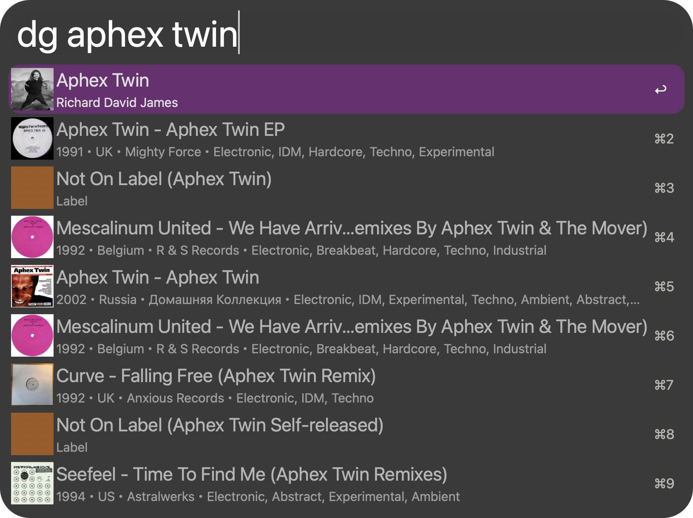

<p align="center">
  
</p>

<h1 align="center">Discogs for Alfred</h1>

<p align="center">Search Discogs releases, artists, labels and masters from Alfred.</p>

<p align="center">
  <a href="https://github.com/aleksgorbenko/alfred-workflow-discogs/actions/workflows/ci.yml"></a>
  <a href="https://github.com/aleksgorbenko/alfred-workflow-discogs/releases/latest"></a>
  <a href="LICENSE"></a>
  
  <a href="https://www.alfredapp.com/powerpack/"></a>
</p>

<p align="center">
  <a href="#commands">Commands</a> ·
  <a href="#install">Install</a> ·
  <a href="#setup">Setup</a> ·
  <a href="#development">Development</a>
</p>

Type `dc` and a query to search the Discogs database as you type.



Alfred Workflow to browse [Discogs](https://www.discogs.com) via the [Discogs API v2.0](https://www.discogs.com/developers).

## Commands

### `dc <query>` - search the Discogs database

Searches releases, artists, labels and masters as you type.

### Navigation

- `↩` or `⇥` on an artist, label or master opens its releases; on a release opens its tracklist.
- The path builds up in the search box (`dc Aphex Twin > Drukqs`); delete the last part to go back.
- The first row of a page is the page itself: `↩` opens it in the browser, `⇥` goes back.
- Words after a path filter that page.
- `⌥↩` on any row opens its Discogs page.

### Maintenance

- `:dc` - cache size (`↩` reveals the folder) and Empty Cache.

## Install

1. Download the latest `Discogs.alfredworkflow` from [Releases](https://github.com/aleksgorbenko/alfred-workflow-discogs/releases).
2. Double-click it - Alfred will prompt to import.
3. Requires [Alfred](https://www.alfredapp.com) with a Powerpack licence.

## Setup

1. Open the workflow in Alfred, click the `[x]` (Configure Workflow) button.
2. Paste your [Discogs personal access token](https://www.discogs.com/settings/developers) into the **Discogs API Token** field (click "Generate new token").

## Development

- Python 3.14, stdlib only.
- `src/dgapi/` - runtime scripts Alfred calls.
- `tools/` - dev-only scripts (bundle verification), not shipped.

```sh
make setup   # install dev tools and the Python environment
make ci      # everything CI runs
make check    # lint + format check + tests
make build    # package dist/Discogs.alfredworkflow
make verify   # audit the built bundle for local paths, tokens, junk files
make release VERSION=v1.0.0
make sync-plist WORKFLOW_DIR=/path/to/installed/workflow   # pull info.plist edits back
make link-live WORKFLOW_DIR=/path/to/installed/workflow    # symlink src/ for live dev
```

## My Other Workflows

- [Netlify for Alfred](https://github.com/aleksgorbenko/alfred-workflow-netlify)
- [WaniKani for Alfred](https://github.com/aleksgorbenko/alfred-workflow-wanikani)
- [2Do for Alfred](https://github.com/aleksgorbenko/alfred-workflow-2do)
- [BunPro for Alfred](https://github.com/aleksgorbenko/alfred-workflow-bunpro)
- [Bandcamp for Alfred](https://github.com/aleksgorbenko/alfred-workflow-bandcamp)
- [config](https://github.com/aleksgorbenko/config) - index of all my workflows, plus macOS/iOS setup
